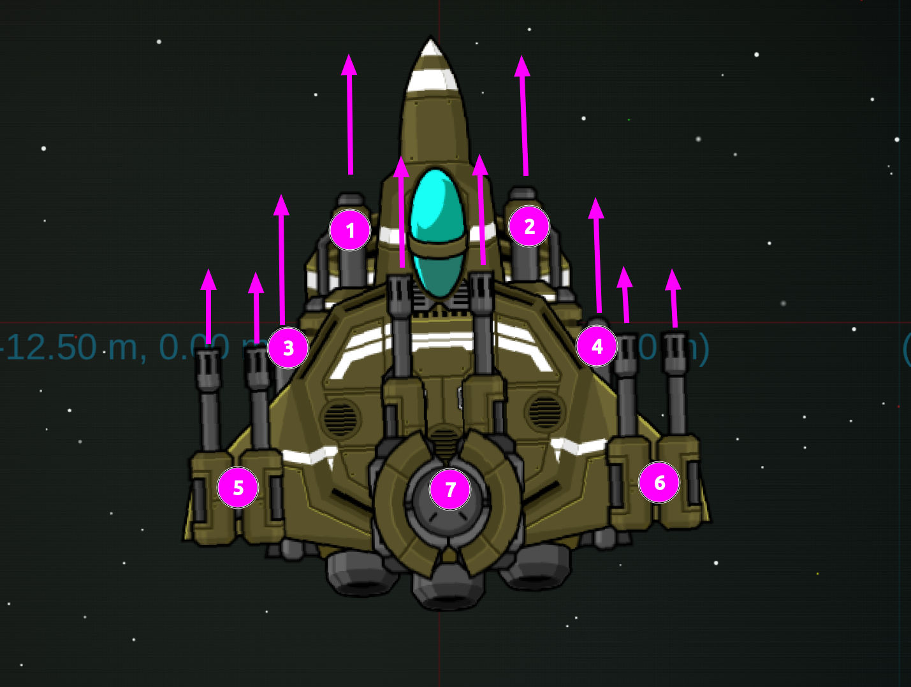

# Original ship weapon reference

Julien supplied this reference on 22 October 2026 for the later weapons slice.
The original ship had seven mount slots; three mounts were double-muzzled.
A mount slot is not a muzzle count. This image is reference material, not a
new firing implementation or a confirmed 3D hardpoint calibration.

Resolve exact muzzle positions, grouping and firing behaviour during ticket #8.
